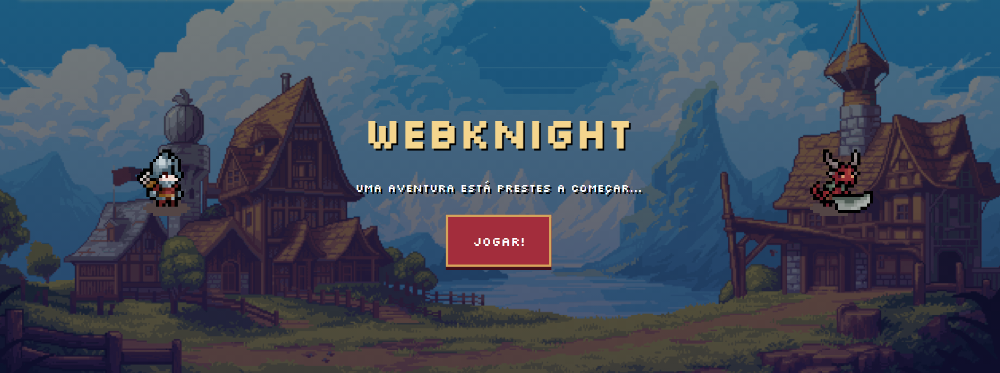

# WebKnight


RPG de combate em turnos desenvolvido em uma página web, para o curso Tecnologia em Sistemas para Internet.

Você acorda em uma floresta escura sem saber como chegou ali. Explore o mapa, encontre os inimigos que vagam pelo cenário e sobreviva às batalhas para avançar de região.

## Tela inicial



É por aqui que tudo começa: no menu central você encontra o botão JOGAR, que abre um modal com as opções de gerar mapa, gerar narrativa e continuar, e o botão CONFIGURAÇÕES, onde ficam as chaves da API do Gemini.

## Jogo até o momento

- **Tela inicial, tela de jogo, tela de batalha e tela de fim**, alternadas por seções na mesma página.
- **Mapa em grade de 10x15 células**, com piso, paredes com objetos decorativos, saída, inimigos e o jogador, renderizado dinamicamente a partir de uma matriz numérica.
- **Geração de mapa com IA (Google Gemini)**: a partir de uma chave de API cadastrada nas configurações, o jogo pede ao Gemini uma matriz de mapa para um dos quatro cenários: Floresta, Cidade, Ruína ou Montanha, cada um com sua própria paleta de cores. Também é possível cadastrar mais de uma chave, e o jogo faz o rodízio entre elas a cada chamada.
- **Mapa padrão de teste** carregado automaticamente ao abrir a página, pra não depender da API durante o desenvolvimento.
- **Movimentação do jogador** com WASD ou setas, suporte a segurar tecla, fila de toques rápidos pra não perder inputs, cooldown entre passos e sprites animados de parado/caminhada nas quatro direções.
- **Movimentação dos inimigos**: após cada movimento bem-sucedido do jogador, todos os inimigos tentam se deslocar aleatoriamente, mantendo o estado de cada entidade (posição + elemento na tela). Cada inimigo tem uma chance de permanecer parado no turno e nunca entra em paredes, sai dos limites do mapa, sobrepõe outros inimigos ou pisa no jogador.
- **Painel do jogador** lateral com atributos (vida, força, defesa, velocidade), região atual e contador de mapas visitados, colapsável em telas pequenas.
- **Classes de personagem** com herança (`Personagem` → `Jogador`, `Personagem` → `Inimigo` → `Vorax`), com atributos privados e getters/seters, prontas pra alimentar as batalhas em turnos.

## Estrutura do projeto

```
webknight/
├── index.html                    Página com as quatro telas do jogo
├── style.css                     Estilos globais
├── assets/                       Imagens, spritesheets, estilos por tela e áudios
│   ├── css/
│   │   ├── tela-inicio.css       Tela inicial
│   │   ├── tela-jogo.css         Tela de jogo e mapa
│   │   ├── tela-batalha.css      Batalha em turnos
│   │   ├── tela-fim.css          Tela de fim com placar de líderes
│   │   ├── painel-jogador.css    Painel lateral do jogador
│   │   └── sprites.css           Spritesheets animadas (cavaleiro, demônio)
│   ├── sprites/                  Spritesheets do jogo (soldado, demônio, cenário)
│   ├── repo/                     Imagens usadas aqui no README
│   └── audio/                    Áudios (em preparação)
├── src/
│   ├── script.js                 Controle de exibição das telas
│   ├── prompt.js                 Comunicação com o Gemini pra gerar mapas
│   ├── mapa.js                   Renderização do mapa e movimentação (jogador e inimigos)
│   ├── painel-jogador.js         Painel de informações do jogador
│   ├── gerenciador-chaves.js     Cadastro e rodízio das chaves da API do Gemini
│   └── classes/
│       ├── Personagem.js         Classe base abstrata
│       ├── Jogador.js            Personagem do jogador
│       ├── Inimigo.js            Classe base dos oponentes
│       ├── Vorax.js              Especialização de inimigo
│       └── Narrativa.js          Narrativa do jogo
```

## Como rodar

O projeto não tem build nem dependências, é só servir a pasta por um servidor HTTP local e abrir no navegador:

```bash
# Com Python
python -m http.server 8000
# Ou com Node
npx serve .
```

Depois acesse `http://localhost:8000`.

> Abrir o `index.html` direto pelo disco (sem servidor) funciona pra ver o mapa, mas o navegador bloqueia a chamada à API do Gemini por `file://`.

## Controles

| Tecla                  | Ação                            |
| ---------------------- | ------------------------------- |
| `W` / `↑`              | Mover pra cima                  |
| `S` / `↓`              | Mover pra baixo                 |
| `A` / `←`              | Mover pra esquerda              |
| `D` / `→`              | Mover pra direita               |
| Segurar a tecla        | Caminha continuamente           |

## Legenda do mapa

A matriz que descreve cada mapa (gerada pelo Gemini ou fixa nos testes) usa estes valores:

| Valor | Célula  | Comportamento                                              |
| ----- | ------- | ---------------------------------------------------------- |
| `0`   | Piso    | Caminhável                                                 |
| `1`   | Saída   | Avança pra próxima região                                  |
| `2`   | Parede  | Intransponível                                             |
| `3`   | Inimigo | Bloqueia o jogador; o inimigo se move sozinho pelo mapa    |
| `4`   | Jogador | Posição inicial do jogador                                 |

## Em desenvolvimento

- Combate em turnos (interface e lógica já reservadas no layout).
- Atributos reais do jogador vindos das classes substituindo os dados de exemplo do painel.
- Narrativa dinâmica por região.
- Placar de líderes na tela de fim.
